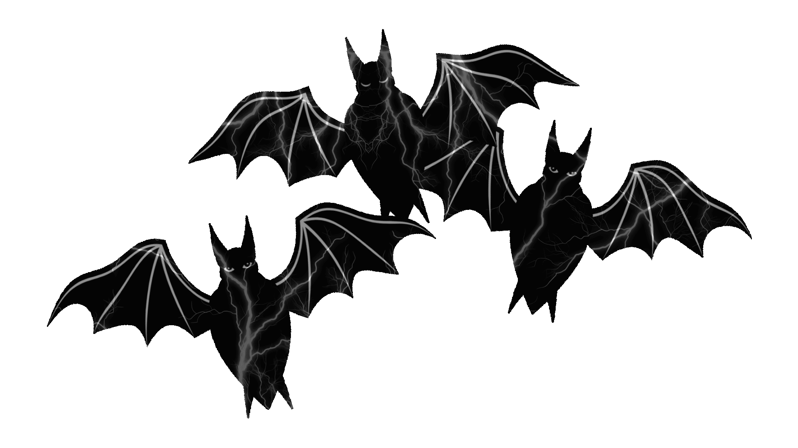

### Hi there, I'm Crisdaniel 👋

I'm a Bachelor of Science in Information Systems (BSIS) student focused on software development, data structures, and algorithmic problem-solving. I enjoy building clean, practical applications and exploring how software works under the hood.

- 🔭 **Currently building:** Custom Data Structures & Algorithms implementations in Python and a personal developer portfolio
- 🌱 **Currently learning:** Advanced algorithmic problem-solving, software architecture, and full-stack web fundamentals
- 💡 **Interests:** Systems logic, command-line utilities, and clean UI/UX structure
- 📫 **Reach me:** crisdanielinot@gmail.com

---

### 🛠️ Tech Stack

  

---

### 📊 GitHub Activity

  
  

